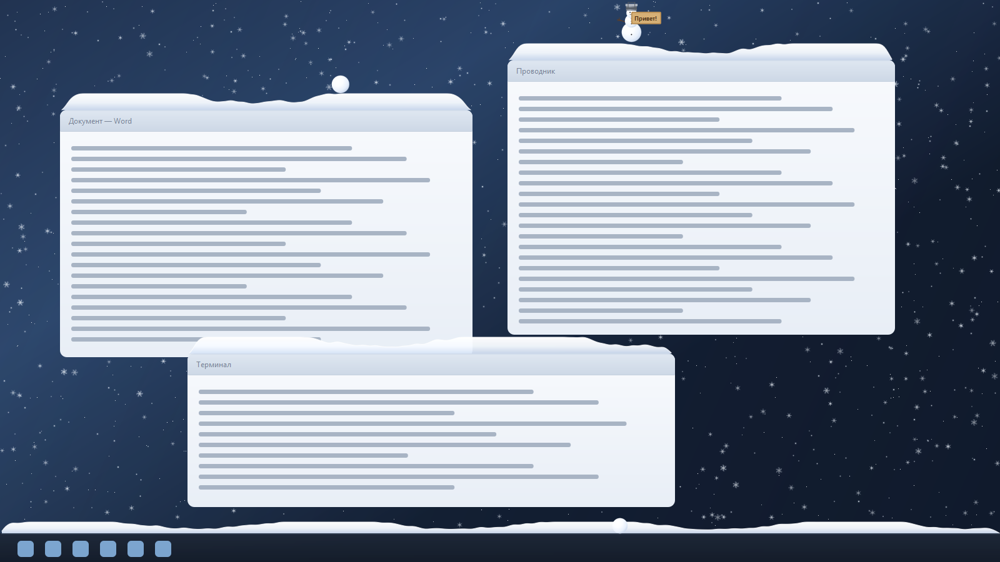

# Flake для Windows 10 / 11

Снег на рабочем столе: снегопад поверх окон, сугробы на кромках окон и панели
задач, снежки и снеговик. Порт приложения
[Flake для macOS](https://github.com/ArturTonoyan/flake) Артура Тонояна
(та самая тема из Instagram — `tryflake.ru`).



## Скачать

Готовый `FlakeWin.exe` — на странице
[Releases](https://github.com/nexttoo/flake-win/releases). Установщик не нужен:
положите файл в любую папку и запустите.

## Что умеет

- **Снегопад** поверх всех окон: снежинки-кристаллы разного размера, ветер,
  порывы, покачивание. Мелкие снежинки сносит сильнее, крупные падают ровнее.
- **Сугробы** растут на верхних кромках окон и на панели задач. Учитываются
  скруглённые углы окон — снег не свисает за них. Слишком крутые склоны
  осыпаются.
- **Мышь**: проведите по сугробу — останется борозда, снег сгребётся в валики.
  Зажмите левую кнопку и покатайте по сугробу — слепится снежок, он растёт.
  Отпустите с размахом — снежок летит, отскакивает от окон и ложится на кромки.
- **Снеговик**: три снежка друг на друге превращаются в снеговика — с морковкой,
  угольками, ветками-руками и ведром на голове. Снеговик стоит на кромке окна,
  его можно перетащить мышью, а раз в 8–18 секунд он сам кидает снежок
  (или сразу подпрыгивает и кидает, если навести мышь).
- **Паровозик**: когда на панели задач накопился снег, выезжает локомотив с
  отвалом, дымом и вагонеткой. Он проходит всю панель, счищает сугроб, и снег
  осыпается вниз с панели. После уборки уезжает и возвращается, когда снега
  снова наберётся достаточно (или по команде из меню).
- **Новогодние обои**: две готовые фотографии (зимняя ночь и зимнее утро), две
  нарисованные сцены и **свои картинки** — любую можно добавить из файла и
  поставить обоями, прежние возвращаются одной кнопкой.
- **Табличка**: правый клик по снеговику — текст на табличке в его руке.
- **Растаять всё** — убрать снег с экрана.

Оверлей прозрачен для мыши и не появляется в панели задач: работать за
компьютером он не мешает.

## Установка

1. Возьмите `FlakeWin.exe` (из `dist\` после сборки) и положите в удобную папку,
   например `C:\Program Files\Flake\`.
2. Запустите. В трее появится снежинка, на экране пойдёт снег.
3. Правый клик по снежинке — меню.

Отдельный установщик не нужен, но при первом запуске Windows SmartScreen может
спросить подтверждение (файл не подписан сертификатом) — «Подробнее» → «Выполнить
в любом случае».

Чтобы приложение стартовало вместе с Windows, включите в меню
**«Запускать с Windows»**.

## Меню (правый клик по снежинке в трее)

| Пункт | Что делает |
| --- | --- |
| Пауза / Продолжить | Останавливает снег, не закрывая приложение |
| Интенсивность → Мало / Средне / Много / Метель | От 0.35 до 1.4 — густота снега |
| Мышь: вкл / выкл | Взаимодействие с сугробами и снежками |
| Растаять всё | Мгновенно убирает снег |
| Снеговик (поставить) | Ставит снеговика на верхнюю кромку самого широкого окна |
| Паровозик → Пустить сейчас | Немедленно отправить локомотив чистить панель задач |
| Паровозик → Катается сам | Автоматические рейсы, когда на панели накопился снег |
| Новогодние обои → Зимняя ночь | Готовая фотография: изба с гирляндами и салютом |
| Новогодние обои → Зимнее утро | Готовая фотография: изба в морозное утро |
| Новогодние обои → Ночная зима (рисованная) | Нарисованная сцена под ваш экран |
| Новогодние обои → Морозное утро (рисованное) | Светлый нарисованный вариант |
| Новогодние обои → Мои обои | Список ваших картинок из папки обоев |
| Новогодние обои → Добавить из файла… | Выбрать картинку и сразу поставить обоями |
| Новогодние обои → Открыть папку обоев | Открыть `%APPDATA%\FlakeWin\wallpaper\custom` |
| Новогодние обои → Вернуть прежние | Вернуть обои, которые были до этого |
| Скрывать снег над развёрнутыми окнами | По умолчанию выключено: снег идёт и поверх развёрнутых окон |
| Запускать с Windows | Автозапуск через `HKCU\...\Run` |
| О программе / Выход | — |

## Управление

- **Вести мышью по сугробу** — разгребать снег.
- **ЛКМ + движение по сугробу** — лепить снежок (он прилипает к курсору).
- **Отпустить ЛКМ** — бросить снежок с учётом скорости движения.
- **ЛКМ по снеговику** — перетащить и поставить на другую кромку.
- **ПКМ по снеговику** — задать текст таблички.
- **Навести на снеговика** — он подпрыгнет и кинет снежок; без наведения тоже
  кидает, но реже.

## Настройки

Хранятся в `%APPDATA%\FlakeWin\settings.json`:

```json
{
  "intensity": 0.7,
  "mouse_enabled": true,
  "paused": false,
  "hide_on_maximized": false,
  "train_enabled": true,
  "wallpaper_backup": "",
  "autostart": false,
  "fps_limit": 30
}
```

Файл можно править вручную при закрытом приложении.

## Новогодние обои

В комплекте — две готовые фотографии и две нарисованные сцены, которые
приложение рисует само под разрешение вашего экрана (интернет не нужен):

| Зимняя ночь | Зимнее утро |
| --- | --- |
|  |  |

| Ночная зима (рисованная) | Морозное утро (рисованное) |
| --- | --- |
|  |  |

### Свои обои

Любую картинку можно поставить обоями прямо из трея:

- **Новогодние обои → Добавить из файла…** — выбрать картинку, она скопируется
  в папку приложения и сразу встанет обоями;
- либо просто положите файл в
  `%APPDATA%\FlakeWin\wallpaper\custom\` и откройте меню заново — он появится в
  разделе **Мои обои**.

Поддерживаются `jpg`, `jpeg`, `png`, `bmp`, `webp`. Лучше всего 16:9 под ваше
разрешение (например, 1920×1080, 2560×1440 или 3840×2160) — картинка ставится в
режиме «заполнить», без растяжения.

Прежние обои запоминаются, пункт **«Вернуть прежние»** возвращает их.

## Совместимость и требования

- Windows 10 (1809+) и Windows 11, x64.
- Несколько мониторов с разным масштабом — поддерживается, на каждый монитор
  свой прозрачный слой.
- Нагрузка: около 1–2 % одного ядра при «Средне», ~3 % при «Метель»
  (30 кадров/с, ~80 МБ памяти).
- Полноэкранные игры и приложения с аппаратным ускорением: снег может быть не
  виден поверх эксклюзивного полного экрана — это ограничение Windows.

## Сборка из исходников

Нужен Python 3.12 x64.

```cmd
build.cmd
```

Скрипт поставит зависимости (`PySide6-Essentials`, `numpy`, `pyinstaller`),
сгенерирует `flake.ico` и соберёт `dist\FlakeWin.exe` (один файл).

Ручной запуск без сборки:

```cmd
python -m pip install PySide6-Essentials numpy
python run_flake.py
```

Полезные режимы:

```cmd
python run_flake.py --selftest preview.png   :: офлайн-рендер кадра и обоев
python check_sim.py                          :: проверка физики и снеговиков
python debug_run.py                          :: диагностика оверлея
python live_features.py                      :: живой прогон (снеговик + паровозик)
python live_train.py                         :: журнал паровозика и уровня снега
```

## Как устроено

| Файл | Назначение |
| --- | --- |
| `flakewin/winapi.py` | Win32/DWM: перечисление окон, границы, панель задач, курсор |
| `flakewin/world.py` | Экраны и перевод физических пикселей в логические |
| `flakewin/tracker.py` | Какие окна дают сугроб, что непроницаемо, где прятать снег |
| `flakewin/drifts.py` | Карта высот сугроба: наметание, осыпание, разгребание |
| `flakewin/sim.py` | Снежинки (numpy), снежки, снеговики, взаимодействие с мышью |
| `flakewin/train.py` | Паровозик: маршрут, дым, расчистка панели задач |
| `flakewin/wallpaper.py` | Отрисовка новогодних обоев и их установка |
| `flakewin/render.py` | Отрисовка QPainter: кристаллы, сугробы, снеговик, поезд |
| `flakewin/overlay.py` | Прозрачные слои на каждый монитор и цикл кадров |
| `flakewin/app.py` | Трей, меню, диалоги, автозапуск |

Ключевые числа перенесены из оригинала: скорость падения
`26 + масса·58` px/с, ветер ±22 с порывами, шаг карты высот 3 px, предельная
высота сугроба 26 px (18 px у панели задач), склон осыпания 0.78.

## Отличия от macOS-версии

- **Снежки по Wi‑Fi** (обмен по локальной сети через Bonjour) не перенесены:
  на Windows это отдельный протокол обнаружения и рассылки.
- **Снеговик с табличкой, улетающий другу** — тоже относится к сетевой части.
- Вместо Dock — панель задач: сугроб растёт на её верхней кромке.
- **Паровозик и новогодние обои** — добавлено в этом порте, в оригинале их нет.
- Окна с топмост-флагом (например, некоторые плееры) дают сугроб только в
  macOS-версии; здесь они не накапливают снег.

## Лицензия и авторство

Код этого порта — MIT (см. [LICENSE](LICENSE)), автор **nexttoo**.

Идея, поведение и название **Flake** принадлежат Артуру Тонояну —
[ArturTonoyan/flake](https://github.com/ArturTonoyan/flake) (Swift, Metal,
macOS). Этот порт написан с нуля на Python + Qt: исходники оригинала не
копировались, но физика и внешний вид повторяют его.

В оригинальном репозитории нет файла лицензии, поэтому все права на
оригинальное приложение остаются у его автора. Если вы автор Flake и хотите
изменить условия распространения этого порта — откройте issue в репозитории.

## Благодарности

- **Артур Тоноян** — за Flake и ту самую зимнюю тему из Instagram.
- Сообществу Qt/PySide — за возможность сделать прозрачный оверлей без
  нативных библиотек.
